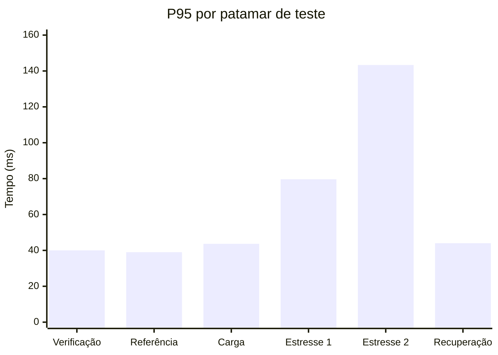
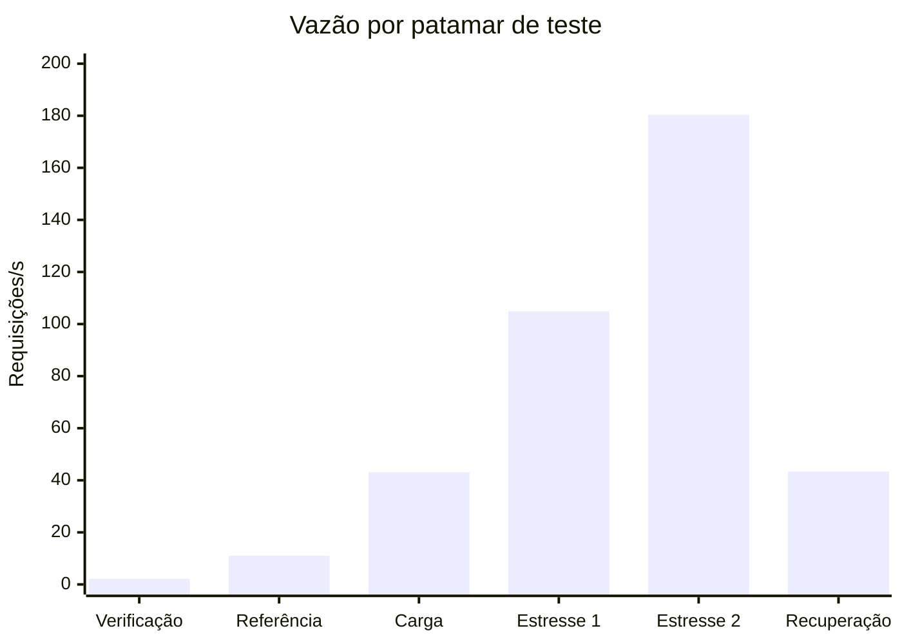
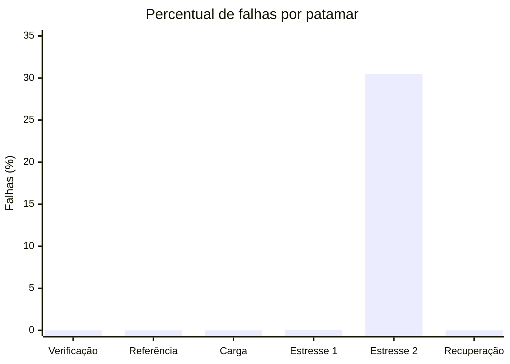

# Plano e Relatório de Teste de Desempenho

Equipe: Kamila Rocha, Vitória Barbosa e Mylena Duarte   Pacote/Projeto: Desafio B de desempenho – Biblioteca e Minicursos   Data: 26/11/2026

## 1. Plano (preencher ANTES de executar)

| Item | Preenchimento |
|---|---|
| Pergunta / hipótese | Verificar se a API de cursos suporta 20 usuários virtuais mantendo p95 ≤ 500 ms e falhas  ≤1%. |
| Operações testadas e proporção | GET /api/cursos: 70%, GET /api/cursos/1: 30% |
| Verificações de conteúdo | Listagem: status 200, total = 3 e presença do curso Python. Detalhe: status 200, id = 1, nome = Python e vagas = 2. |
| Think time (pausa entre ações) | Entre 0,2 e 0,6 segundo. |
| Massa de dados | Três cursos cadastrados na aplicação: Python, Java e Testes de Software. |
| Perfis (usuários, ritmo, duração) | Verificação: 1 usuário, 1 usuário/s, 15 s. Referência: 5 usuários, 1 usuário/s, 90 s. Carga nominal: 20 usuários, 2 usuários/s, 90 s. Estresse 1: 50 usuários, 5 usuários/s, 90 s. Estresse 2: 100 usuários, 10 usuários/s, 90 s. Recuperação: 20 usuários, 2 usuários/s, 90 s. |
| Repetições | Três repetições para cada patamar de referência, carga nominal e estresse, utilizando arquivos com nomes diferentes. Verificação inicial e recuperação realizadas uma vez cada. |
| Metas (SLA) | p95 ≤ 500 ms; falhas ≤ 1%; outras: após o estresse, retornar às metas com 20 usuários em até 30 segundos. |
| Critério de parada | Sugestão da equipe: interromper se as falhas ultrapassarem 20% por 10 segundos ou se o p95 ultrapassar 2.000 ms por 10 segundos. |

## 2. Ambiente

| Item | Valor |
|---|---|
| Processador / memória | Intel Core i5-13420H (13ª geração) / 8 GB RAM LPDDR5 |
| Sistema operacional | Windows 11 |
| Python ou JDK (versão) | Python 3.14.3 |
| Ferramenta e versão (Locust/Gatling) | Locust 2.47.0 |
| Servidor e gerador de carga na mesma máquina? | Sim |

## 3. Resultados

### Tabela-resumo dos resultados

| Cenário | Usuários | Requisições (média) | P95 (ms) | Req/s (média) | Falhas |
|---|---:|---:|---:|---:|---:|
| Verificação | 1 | 30 | 40 | 2,15 | 0% |
| Referência | 5 | 976 | 39 | 11,00 | 0% |
| Carga nominal | 20 | 3.829 | 43,67 | 43,06 | 0% |
| Estresse 1 | 50 | 9.349 | 79,67 | 104,87 | 0,03% |
| Estresse 2 | 100 | 16.022 | 143,33 | 180,33 | 30,49% |
| Recuperação | 20 | 3.835 | 44 | 43,31 | 0% |

### Gráfico 1 — P95 por patamar

### Gráfico 2 — Requisições por segundo (Req/s)

### Gráfico 3 — Percentual de falhas por patamar

## 4. Análise

### 4.1. A meta foi atendida em cada teste? Em qual patamar deixou de ser?

O sistema atendeu às metas estabelecidas nos testes de verificação inicial, referência, carga nominal e Estresse 1, realizados com até 50 usuários simultâneos. No Estresse 2, com 100 usuários, o sistema deixou de atender ao SLA, apresentando taxas de falhas entre 30,38% e 30,64%, ultrapassando o limite estabelecido de 1%. Apesar do aumento das falhas, o P95 permaneceu abaixo de 500 ms em todas as execuções. No teste de recuperação, com 20 usuários, o sistema voltou a atender às metas, registrando P95 de 44 ms e nenhuma falha.

### 4.2. Qual endpoint piora primeiro? A vazão parou de crescer em algum ponto?

A operação de listagem (`GET /api/cursos`) apresentou maior proporção de falhas no patamar de 50 usuários nas repetições R2 e R3 e também no patamar de 100 usuários, quando os dois endpoints passaram a apresentar taxas elevadas de falhas. No Estresse 2, a listagem apresentou aproximadamente 30,68%, 30,81% e 30,98% de falhas nas três repetições, enquanto a operação de detalhe (`GET /api/cursos/1`) apresentou aproximadamente 29,68%, 30,25% e 29,24%. Entretanto, os resultados agregados não permitem determinar exatamente em qual momento cada endpoint começou a piorar.

A vazão continuou crescendo conforme o número de usuários aumentou, passando de aproximadamente 11 requisições por segundo com 5 usuários para 43 com 20 usuários, 105 com 50 usuários e 180 com 100 usuários. Portanto, não houve uma interrupção do crescimento da vazão, mas o patamar de 100 usuários apresentou um aumento expressivo na taxa de falhas, indicando perda de capacidade de atendimento bem-sucedido.

### 4.3. O sistema se recuperou após o estresse? Em quanto tempo?

Sim. O sistema apresentou recuperação dentro do limite de 30 segundos estabelecido. Aproximadamente 9 segundos após o início do teste de recuperação, já havia alcançado 20 usuários simultâneos, apresentando P95 de 44 ms e nenhuma falha registrada. O sistema manteve esse comportamento estável durante o restante do teste, demonstrando que conseguiu retornar às metas de desempenho após o estresse.

### 4.4. As repetições deram resultados parecidos? O que explica as diferenças?

As repetições apresentaram resultados semelhantes em todos os patamares de teste, demonstrando consistência no comportamento da aplicação. Nos testes de referência e carga nominal, os tempos de resposta permaneceram próximos e não foram registradas falhas. No Estresse 1, as variações também foram pequenas, com poucas falhas. Já no Estresse 2, as três execuções apresentaram taxas de falhas próximas de 30%, indicando que o comportamento do sistema se manteve semelhante mesmo com 100 usuários simultâneos. As pequenas diferenças nos tempos de resposta, na quantidade de requisições e nas falhas podem estar relacionadas à variação natural das condições de execução, mas os dados disponíveis não permitem identificar uma causa específica.

## 5. Limitações e recomendações

- Limitações: Os testes foram realizados com a aplicação e o Locust na mesma máquina, o que pode influenciar os resultados. Além disso, foram avaliados apenas dois endpoints e uma massa de dados com três cursos. No teste com 100 usuários, a taxa de falhas ultrapassou o limite estabelecido no SLA.

- Recomendações: Investigar as causas das falhas no teste de estresse, realizar novos testes com aplicação e gerador de carga em máquinas separadas e ampliar a massa de dados e a quantidade de endpoints avaliados. Após possíveis melhorias, repetir os testes para verificar o desempenho do sistema.
